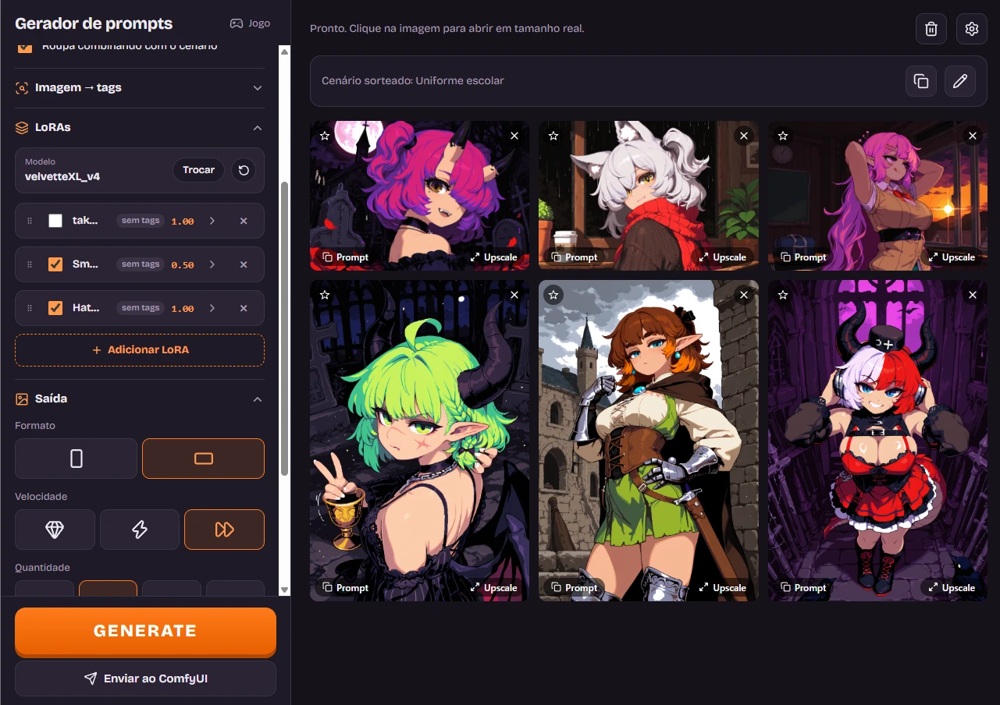

# Gerador de prompts para ComfyUI

Gera prompts aleatórios para imagens com IA e manda direto para o ComfyUI, com um clique.



## Índice

- [Como começou](#como-começou)
- [Instalação passo a passo](#instalação-passo-a-passo)
- [Como usar](#como-usar)
- [Recursos](#recursos)
  - [Gerador de prompts](#gerador-de-prompts)
  - [Jogo](#jogo)
- [Requisitos no ComfyUI](#requisitos-no-comfyui)
- [Workflows](#workflows)
- [Como contribuir](#como-contribuir)
- [Créditos](#créditos)
- [Licença](#licença)

## Como começou

Este projeto nasceu de uma vontade simples: eu queria criar imagens com IA, mas sem ter que pensar em cada prompt. Queria que o computador montasse as ideias sozinho, de forma automática e aleatória, misturando personagens, roupas, poses e cenários que eu nunca teria combinado de propósito.

Foi assim que surgiu o gerador: um botão que sorteia tudo e manda direto para o ComfyUI. O mais legal é a surpresa. Cada clique pode virar uma combinação inesperada, e às vezes é dali que sai a imagem mais interessante do dia.

Com o tempo vieram as favoritas, os LoRAs, os perfis por modelo e uma página só para os retratos e as folhas de personagem de um jogo. Mas a essência continua a mesma: apertar GENERATE e deixar o acaso trabalhar.

## Instalação passo a passo

Do zero até a primeira imagem. Os passos 1 a 5 são feitos uma vez só.

### 1. Instale o ComfyUI

Baixe o **ComfyUI Desktop** em [comfy.org/download](https://www.comfy.org/download), instale e abra uma vez para ele terminar de configurar. Ele já vem com o **ComfyUI Manager**, que instala os nodes do passo 3.

> Já usa o ComfyUI portátil (a versão em pasta, do GitHub)? Também funciona; as diferenças aparecem nos passos 2 e 3.

### 2. Libere o acesso do app ao ComfyUI

O app conversa com o ComfyUI pelo navegador, e o ComfyUI só aceita isso com o CORS liberado.

- **ComfyUI Desktop:** abra **Configurações** (engrenagem) → **Server-Config** e preencha:
  - **Enable CORS header:** `*`
  - **Preview method:** `auto` (para ver a imagem aparecendo enquanto é gerada)

  Depois feche o ComfyUI por completo (inclusive o ícone perto do relógio) e abra de novo.
- **ComfyUI portátil:** edite o arquivo `run_nvidia_gpu.bat` e acrescente no fim da linha que chama o `main.py`:

  ```
  --enable-cors-header "*" --preview-method auto
  ```

### 3. Instale os nodes extras

No ComfyUI, abra o **Manager** → **Custom Nodes Manager**, procure e instale cada um:

| Node | Para que serve | Obrigatório? |
|---|---|---|
| [rgthree-comfy](https://github.com/rgthree/rgthree-comfy) | Power Lora Loader (os LoRAs da lista) | Sim |
| [ComfyUI_UltimateSDUpscale](https://github.com/ssitu/ComfyUI_UltimateSDUpscale) | Tile upscale e Upscale "Com detalhes" | Sim |
| [ComfyUI-WD14-Tagger](https://github.com/pythongosssss/ComfyUI-WD14-Tagger) | Imagem → tags | Só para essa função |

Reinicie o ComfyUI por completo depois de instalar.

> **WD14 Tagger com "IMPORT FAILED" no log?** Falta o pacote `onnxruntime`. Instale no Python do ComfyUI e reinicie:
> - Desktop: `<pasta do ComfyUI>\.venv\Scripts\python.exe -m pip install onnxruntime`
> - Portátil: `python_embeded\python.exe -m pip install onnxruntime`

### 4. Baixe os modelos

Coloque cada arquivo na pasta indicada, dentro de `models` do ComfyUI. **Os nomes precisam ser exatamente estes**, porque o app chama os arquivos pelo nome.

| Arquivo | Pasta | Onde achar | Para quê |
|---|---|---|---|
| `waiIllustriousSDXL_v170.safetensors` | `checkpoints` | Civitai, procure "WAI-Illustrious-SDXL" | Modelo padrão (dá para trocar no app) |
| `4x-UltraSharp.safetensors` | `upscale_models` | [OpenModelDB](https://openmodeldb.info/models/4x-UltraSharp) | Hires fix e upscale |
| `dmd2_sdxl_4step_lora_fp16.safetensors` | `loras` | [Hugging Face: tianweiy/DMD2](https://huggingface.co/tianweiy/DMD2) | Hires fix rápido |
| `flux-2-klein-4b-fp8.safetensors` | `diffusion_models` | Hugging Face, procure "Flux 2 Klein 4B" | Character sheet (opcional) |
| `qwen3_4b_fp8_scaled.safetensors` | `text_encoders` | Hugging Face, junto do Flux 2 Klein | Character sheet (opcional) |
| `flux2-vae.safetensors` | `vae` | Hugging Face, junto do Flux 2 Klein | Character sheet (opcional) |

Outro checkpoint Illustrious/SDXL também serve no lugar do WAI: depois é só escolher ele no app (passo 6).

### 5. Baixe o app

Nesta página do GitHub, clique em **Code** → **Download ZIP** e extraia numa pasta. Não precisa instalar nada: o app são os arquivos `gerador-comfyui.html` e `jogo.html`.

> Prefira **Chrome, Edge ou Brave**. No **Firefox** o app funciona, mas o gerador e o jogo deixam de compartilhar LoRAs, favoritas e checkpoint, porque ele guarda os dados de cada arquivo separado.

### 6. Primeira imagem

1. Com o ComfyUI aberto, dê dois cliques em `gerador-comfyui.html`.
2. Se o ComfyUI não estiver no endereço padrão (`http://127.0.0.1:8188`), corrija em **Conexão**.
3. Se você baixou outro checkpoint, vá em **LoRAs** → linha **Modelo** → **Trocar** e escolha o seu.
4. Clique em **GENERATE** e depois em **Enviar ao ComfyUI**. A imagem aparece na galeria ao lado.

Pronto. A partir daqui é só repetir o passo 6. Para ter os seus LoRAs no sorteio, use **Adicionar LoRA**; para não perder as configurações, use o **Backup** na engrenagem.

## Como usar

São duas páginas HTML independentes (sem build, sem dependências locais):

- `gerador-comfyui.html`: gerador de prompts aleatórios no formato de 4 blocos (qualidade, personagem, roupa, cenário), com envio direto ao ComfyUI.
- `jogo.html`: retratos de personagens do jogo (expressões, enquadramento, fundo) e character sheet para criadores 3D, com a mesma integração.

Basta abrir os arquivos no navegador. O ComfyUI precisa estar rodando (padrão `http://127.0.0.1:8188`) e ser iniciado com `--enable-cors-header "*"`. Para a prévia ao vivo das imagens, use também `--preview-method auto`. Veja o que mais ele precisa em [Requisitos no ComfyUI](#requisitos-no-comfyui).

## Recursos

### Gerador de prompts

**Sorteio do prompt**
- Personagem: garota, garoto, sorteio ou uma favorita salva.
- Raça (fox, angel, dragon, elf, demon, wolf, oni, fairy...), cenário (cidade à noite, café, medieval, fantasia, inverno, gótico, praia, piscina...) ou modo livre, com todas as tags misturadas.
- Enquadramento: retrato, meio corpo, cowboy shot, corpo inteiro ou só o fundo (sem personagem). Também pode ser sorteado.
- **Limitado ao enquadramento** (ligado por padrão): tira do prompt o que fica fora do quadro, para a câmera não se afastar tentando mostrar uma roupa ou pose que não cabe. Vale também quando o enquadramento é sorteado:

  | Enquadramento | O que fica de fora |
  |---|---|
  | Retrato, rosto, close-up | Roupa do corpo, poses de perna e de mão, tipo de corpo e cauda. Só entram acessórios da cabeça e do pescoço (chapéu, brinco, óculos, gola, cachecol, colar). |
  | Meio corpo, busto | Peças da cintura para baixo (saia, calça, botas, meias) e poses de perna. |
  | Cowboy shot | Calçados e meias. |
  | Corpo inteiro | Nada. |

  Com a opção desligada, volta o sorteio livre: roupa e pose do corpo todo entram em qualquer enquadramento. Fica menos fiel ao quadro escolhido, mas às vezes sai uma imagem mais inesperada e interessante.
- Roupa combinando com o cenário, ou sorteada à parte.
- Modo ousado (opcional): roupas e poses mais sugestivas, sem nudez.
- O prompt pode ser editado antes de enviar.

**Imagem → tags**
- Solte, cole (Ctrl+V) ou escolha uma imagem, e o WD14 Tagger do ComfyUI extrai as tags e monta o prompt nos blocos certos.
- Sensibilidade e modelo do tagger ajustáveis.

**LoRAs e modelos**
- LoRAs escolhidos da lista do ComfyUI, com busca, força de 0 a 2, minimizar e arrastar para reordenar.
- Tags de ativação lidas do próprio arquivo do LoRA, ou coladas do Civitai, cada uma com a posição no prompt (início, personagem, roupa, cenário).
- Troca de checkpoint com busca e lista de usados recentemente.
- Perfil por checkpoint: steps, CFG, sampler, scheduler, clip skip, tamanhos, denoise do hires, prompt de qualidade e negativo. Ao trocar o modelo, o perfil troca junto. Preset pronto do Velvette-XL V4.
- Aviso antes de enviar quando um LoRA ou modelo não existe mais no ComfyUI.

**Geração**
- Formato retrato ou paisagem; velocidade Completo, Rápido ou Ultra-rápido.
- Fila de 1, 3, 6 ou 12 imagens, cada uma com um prompt sorteado diferente.
- Progresso ao vivo em cada imagem: etapa, porcentagem, prévia e posição na fila, com estimativa de tempo.
- Seed aleatória ou fixa; uma seed só identifica a imagem inteira.
- Atalho: Espaço gera um prompt novo.

**Galeria e visualizador**
- Histórico das últimas 60 imagens, que continua lá ao reabrir a página.
- Tela cheia com zoom (roda do mouse, pinça no celular), arrastar e setas para navegar.
- Favoritar a personagem da imagem, copiar prompt, copiar seed, ver os LoRAs usados.
- Variar (mesma ideia, outra seed), Hires fix (arruma rosto e mãos da imagem pronta) e Upscale (Fiel, só aumenta; ou Com detalhes).
- Cancelar uma imagem na fila pelo ×.

**Configurações (engrenagem no canto superior direito)**
- **Animações:** liga as animações da galeria e do visualizador. Elas usam a biblioteca anime.js, baixada da internet só quando a opção está ligada.
- **Aviso sonoro ao terminar a fila:** toca um bipe quando a última imagem da fila fica pronta, para você poder fazer outra coisa enquanto gera.
- **Upscale:** escolhe como o botão Upscale do visualizador amplia a imagem.
  - *Fiel:* só aumenta com o 4x-UltraSharp. Não redesenha nada: a anatomia fica igual.
  - *Com detalhes:* aumenta e redesenha de leve, por blocos. Fica mais nítido, mas pode mudar detalhes pequenos.
- **Hires fix: denoise:** quanto o botão Hires fix redesenha a imagem (de 0.05 a 0.8). Em 0.30 ele arruma rosto, mãos e olhos sem mudar a pose; acima de 0.45 a pose pode mudar.
- **Modo ousado:** ligado, o sorteio inclui roupas e poses mais sugestivas (sem nudez). Desligado, essas tags saem e o prompt começa com a tag `general`, que pede uma imagem para todos os públicos.
- **Backup:** *Exportar* baixa um arquivo `.json` com as favoritas, LoRAs, perfis dos modelos, personagens do jogo, negativos e históricos; *Importar* carrega esse arquivo de volta. As configurações ficam só no navegador, então faça um backup antes de limpar os dados dele ou de trocar de navegador.

**Outras**
- Negativo editável por modelo, na seção Negativo.
- Tema claro ou escuro automático, seguindo o do sistema; funciona também no celular.

### Jogo

**Retratos de personagens**
- Personagens salvos com nome, gênero, aparência, roupa e LoRA próprio; importa as favoritas do gerador.
- Uma imagem por expressão marcada: neutro, feliz, sorriso leve, raiva, tristeza, surpresa, vergonha e determinação.
- Enquadramento (rosto, retrato, busto, meio corpo), visão (frente, lado, três quartos) e fundo (branco, cinza, escuro, degradê, pergaminho, moldura de RPG). Cada enquadramento pede só o que cabe no quadro.
- Formato retrato ou quadrado, e cadeado de seed para manter o mesmo rosto entre expressões.

**Character sheet (3D)**
- Solte a imagem de uma personagem e o Flux 2 Klein 4B redesenha a mesma personagem nas vistas pedidas, em fundo branco, pronta para criadores 3D.
- Modelos de instrução: corpo (frente, lado e costas), corpo em pose T e rosto (frente e perfil), todos editáveis.
- Formato igual à imagem ou largo (16:9), Variar e Upscale 2x sem redesenhar.

## Requisitos no ComfyUI

- Checkpoint SDXL/Illustrious (padrão: `waiIllustriousSDXL_v170`), `4x-UltraSharp`, LoRA `dmd2_sdxl_4step_lora_fp16` e os nodes Power Lora Loader (rgthree) e Ultimate SD Upscale.
- Imagem → tags: custom node WD14 Tagger (pysssss), que precisa do pacote `onnxruntime` no Python do ComfyUI.
- Character sheet: `flux-2-klein-4b-fp8`, `qwen3_4b_fp8_scaled` e `flux2-vae`.

As configurações ficam no armazenamento do navegador. Use o backup antes de limpar os dados dele ou de trocar de navegador.

## Workflows

Os workflows já vêm embutidos nas páginas; a pasta [`workflows`](workflows) tem as mesmas versões em arquivo, no formato API do ComfyUI, para conferir os nodes e modelos ou abrir no ComfyUI (arraste o arquivo para a tela dele):

- [`illustrious-api.json`](workflows/illustrious-api.json): geração do gerador e dos retratos do jogo (KSampler, hires fix com DMD2 e tile upscale). O app troca prompt, LoRAs, checkpoint, tamanho e seed a cada envio.
- [`flux-2-klein-4b-api.json`](workflows/flux-2-klein-4b-api.json): character sheet do jogo. O app troca a imagem de referência, a instrução e a seed.

## Como contribuir

- Achou um bug ou teve uma ideia? Abra uma [issue](../../issues) contando o que aconteceu, qual página (gerador ou jogo) e, se tiver, a mensagem que apareceu no topo da tela.
- Quer mudar algo? Faça um fork, altere o HTML e mande um pull request explicando o que mudou e como testou.
- O projeto não tem build nem dependências: cada página é um arquivo HTML só. As duas páginas repetem parte do código (LoRAs, checkpoint, envio ao ComfyUI); ao mudar uma dessas partes, confira se a outra página precisa da mesma mudança.
- As ideias que ainda não foram feitas estão no [TODO.md](TODO.md).

## Créditos

- Preset do Velvette-XL: prompt de qualidade, negativo e configurações recomendadas pelo autor do modelo na [página do Civitai](https://civitai.com/models/1972843).
- Modelos e nodes usados pelos workflows pertencem aos respectivos autores: WAI-Illustrious, 4x-UltraSharp, DMD2, rgthree (Power Lora Loader), Ultimate SD Upscale, WD14 Tagger (pysssss) e Flux 2 Klein (Black Forest Labs).

## Licença

[MIT](LICENSE): pode usar, modificar e distribuir, desde que mantenha o aviso de copyright.
